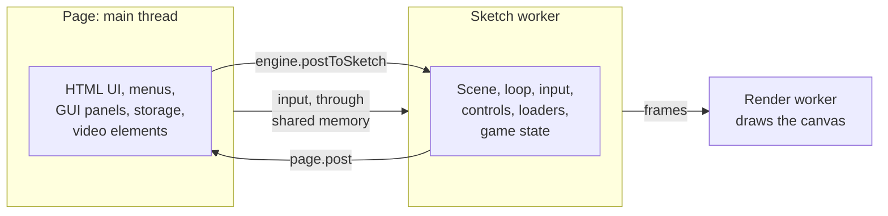

# The render loop, threads and the DOM

> Roadmap step 0.3, first released in null3D 0.1.0. The API is experimental, so it can still change between versions.



A three.js app usually runs everything on the main thread: the DOM, input, scene updates and drawing. null3D splits the app in two. The page module runs on the main thread and keeps the HTML. The sketch runs in a worker and keeps the scene. The two talk through small messages.

This page shows where each part of a three.js app goes, how the loop converts, and how the two sides talk. [Architecture: threads and the frame](../concepts/architecture.md) explains the threads themselves.

## What goes where

| Part of the three.js app | Where it goes | How |
| --- | --- | --- |
| `<canvas>` or `renderer.domElement` | `index.html` and the page module | Put the canvas in the HTML, and pass it to `createEngine` |
| Renderer options: antialias, alpha, pixel ratio, tone mapping | `createEngine` options and `post.set` | The [mapping](threejs-mapping.md) lists each option |
| Resize handling | Nowhere | The engine follows the canvas's CSS size |
| Scene, cameras, lights, meshes and loaders | The sketch | The setup function of `defineSketch` |
| The animation loop | The sketch | `onUpdate`, `onFixedUpdate` and `onLateUpdate` |
| DOM input listeners for the 3D view | The sketch | `ctx.input`, which the page fills through shared memory |
| Camera controls | The sketch | `@null3d/controls` |
| HTML UI, menus, a HUD, lil-gui panels | The page | Messages to and from the sketch |
| `CSS2DRenderer` and `CSS3DRenderer` labels | Both | `ui.trackLabel` in the sketch and `engine.labels.bind` on the page |
| Positional audio | Both | `@null3d/sound`: the sketch places the sounds, and the page plays them |
| Video elements | The page | `engine.registerVideo` on the page and `textures.fromVideo` in the sketch |
| `localStorage`, cookies and URL parameters | The page | Send the sketch what it needs at the start |
| `fetch` of JSON, binary data and models | The sketch | Workers have `fetch`, and relative addresses resolve against the page |
| Physics libraries | The sketch | WebAssembly physics runs in workers |
| Analytics, ads and routing | The page | No change |

Workers have no `localStorage`, but they have IndexedDB. A sketch can keep a cache of generated geometry there, as arrays.

## Converting the loop

A three.js loop:

```js
const clock = new THREE.Clock();
function animate() {
  requestAnimationFrame(animate);
  const dt = clock.getDelta();
  updatePlayer(dt);
  updateEnemies(dt);
  physicsWorld.step(1 / 60, dt, 3);
  followCamera(player);
  controls.update();
  composer.render();
}
animate();
```

The same loop in a sketch:

```ts
return {
  onFixedUpdate() {
    physicsWorld.step();
    syncBodies();
  },
  onUpdate(dt) {
    updatePlayer(dt);
    updateEnemies(dt);
    controls.update(dt);
  },
  onLateUpdate() {
    followCamera(player);
  },
};
```

- `clock.getDelta()` becomes the `dt` argument, which `ctx.time.dt` also holds. `clock.getElapsedTime()` becomes `ctx.time.now`.
- Physics moves to `onFixedUpdate`. It runs at the rate that `defineSketch(setup, { fixedRate: 60 })` sets, 60 steps per second by default. One `world.step()` call per fixed step replaces `world.step(1 / 60, dt, 3)`.
- Code that makes the camera follow an object moves to `onLateUpdate`. The camera then sees the frame's final positions, and its move shows in the same frame.
- The render call and `composer.render()` go away. The engine draws each frame by itself.
- Code that ran every N frames can test `ctx.time.frame % N === 0`.

[Sketch API](../api/sketch.md#the-callbacks) gives the order of the callbacks.

## Per-object classes become arrays

three.js code often wraps each object in a class with an `update()` method. That shape allocates, calls setters one object at a time, and scatters data across memory:

```js
class Enemy {
  constructor(scene) {
    this.mesh = new THREE.Mesh(geo, mat);
    this.vel = new THREE.Vector3();
    scene.add(this.mesh);
  }
  update(dt, player) {
    const dir = player.position.clone().sub(this.mesh.position).normalize(); // allocates
    this.vel.lerp(dir, 0.1);
    this.mesh.position.addScaledVector(this.vel, dt);
  }
}
enemies.forEach((e) => e.update(dt, player));
```

In null3D, the enemies become one instance batch, and their state becomes typed arrays:

```ts
const N = 2000;
const enemies = scene.createInstances(enemyMesh, N, { material: enemyMaterial, dynamic: true });
const vel = new Float32Array(N * 3);
const playerPos = new Float32Array(3);

function updateEnemies(dt: number) {
  player.getPosition(playerPos);
  const p = enemies.positions;
  for (let i = 0; i < N; i++) {
    const o = i * 3;
    let dx = playerPos[0] - p[o];
    let dy = playerPos[1] - p[o + 1];
    let dz = playerPos[2] - p[o + 2];
    const len = Math.sqrt(dx * dx + dy * dy + dz * dz) || 1;
    dx /= len; dy /= len; dz /= len;
    vel[o] += (dx - vel[o]) * 0.1;
    vel[o + 1] += (dy - vel[o + 1]) * 0.1;
    vel[o + 2] += (dz - vel[o + 2]) * 0.1;
    p[o] += vel[o] * dt;
    p[o + 1] += vel[o + 1] * dt;
    p[o + 2] += vel[o + 2] * dt;
  }
}
```

Enemies with different meshes become one batch per mesh. An enemy from a glTF file with several meshes takes `scene.createInstances(prefab, N, { dynamic: true })`, so one row moves every mesh of the model. Keep health, targets and timers in typed arrays indexed by row. When an enemy dies, move the last live row into its place and lower the batch's active count with `setActiveCount`.

## Messages between the page and the sketch

Messages go one way and do not wait for a reply. The browser copies their data, so keep them small and send them only when something changes.

```ts
// sketch.ts
page.post('score', { value: score }); // when the score changes
page.onMessage((name, data) => {
  if (name === 'settings') applySettings(data);
});
```

```ts
// page.ts
engine.onSketchMessage((name, data) => {
  if (name === 'score') scoreElement.textContent = String((data as { value: number }).value);
});
engine.postToSketch('settings', { volume: 0.8 });
```

- Send events and changes, not state for every frame. A three.js app that writes a speed into the DOM every frame sends it only when it changes by a visible amount.
- HTML elements that follow objects use `ui.trackLabel`, which sends no messages.
- Give the message names a TypeScript union type that both modules import, so a typo fails at compile time.
- Large data, such as a level file, goes straight to the sketch with `fetch`, not through the page.
- Engine objects belong to the sketch. To name one in a message, send a name or a number that stands for it.

[Messages between sketch and page](../api/page.md) gives the full rules, such as the order of messages and when they arrive.

## Input and camera controls

The page forwards keyboard, pointer, touch and gamepad input to the sketch through shared memory. The sketch reads it in `ctx.input`.

| three.js | null3D |
| --- | --- |
| `addEventListener('pointermove', ...)` with screen math | `input.pointer.ndcX` and `ndcY`, or `input.pointer.x` and `y` in CSS pixels |
| `addEventListener('keydown', ...)` with a key state object | `input.isDown('KeyW')` and `input.wasPressed('Space')` |
| `addEventListener('touchstart', ...)` with a list of touches | `input.touches`, with `touch-action: none` on the canvas |
| Gamepad API polling | `input.isDown('GamepadA')` and `input.value('GamepadLeftStickRight')` |
| `OrbitControls` and `MapControls` | `createOrbitControls(ctx, camera, options)` and `createMapControls`, with `controls.update(dt)` each frame |
| `FlyControls` and `FirstPersonControls` | `createFlyControls` and `createFirstPersonControls`, with the same option names |
| `PointerLockControls` | `createFirstPersonControls` with `movementSpeed: 0`, and `engine.requestPointerLock()` in a click handler on the page |
| `controls.listenToKeyEvents(window)` | `controls.listenToKeyEvents()`, with no element: the controls read the keys from the sketch's input |
| Clicks on UI buttons over the canvas | Handle them on the page, and send the action to the sketch |

Pointer events on HTML elements above the canvas do not reach the engine. To stop the wheel from scrolling the page over the canvas, the page adds a wheel listener that calls `preventDefault`:

```ts
canvas.addEventListener('wheel', (e) => e.preventDefault(), { passive: false });
```

[Input](../api/input.md) and [Controls](../api/controls.md) give the details.

## Libraries in a port

| Library | What to do |
| --- | --- |
| lil-gui, dat.gui, Tweakpane | Keep them on the page, and send the values to the sketch |
| stats.js | `debug.stats(true)` in the sketch, or `createEngine({ stats: true })` on the page; `engine.measure(seconds)` gives percentiles |
| GSAP, tween.js | For a scene value, `scene.animateProperty`. DOM tweens stay on the page |
| cannon-es, Rapier, Ammo | Run them in the sketch, and copy the transforms into dynamic objects or batches after each step |
| three-mesh-bvh | Delete it, because raycasts use the engine's own acceleration structures |
| troika-three-text | HTML labels, a texture with the text drawn in it, or a text mesh baked into glTF |
| pmndrs postprocessing | `post.set` and `post.addEffect`, as [Porting post-processing](threejs-postprocessing.md) shows |
| three-stdlib and other addons | Look each import up in the [mapping](threejs-mapping.md), since many are built into the engine |

[Using a physics library](../guides/physics.md) shows a physics library in a sketch.

## A sketch on the main thread

`createEngine({ sketchThread: 'main' })` runs the sketch on the page's main thread, where it can reach the DOM. A large app can port its three.js calls first in this mode, then move its DOM code to the page. The render and job workers keep running. But the sketch then shares the main thread with the page, so layout work and page scripts can delay frames.

A page without cross-origin isolation also runs the sketch on the main thread, in the single-threaded build. [Hosting and cross-origin isolation](../getting-started/hosting.md) shows the two headers that turn on worker threads.

## Related pages

- [Porting from three.js](threejs-overview.md)
- [Architecture: threads and the frame](../concepts/architecture.md)
- [Messages between sketch and page](../api/page.md)
- [Sketch API](../api/sketch.md)
- [UI, HTML overlays and labels](../guides/ui-overlays.md)
- [Porting React Three Fiber](react-three-fiber.md)
