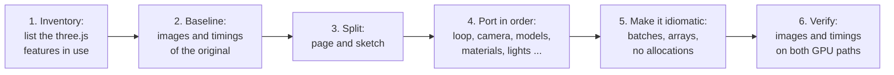

# Porting from three.js

> Roadmap step 0.3, first released in null3D 0.1.0. The API is experimental, so it can still change between versions.



A good port looks like the original, runs faster, and reads like null3D code. A port that copies three.js line by line can match the look at best. Some three.js habits keep the original's speed problems, and some do not work at all, because sketch code runs in a worker. So port by intent: work out what each part of the original does, then write it the null3D way.

This page gives the workflow and the main differences. The [three.js to null3D mapping](threejs-mapping.md) gives the null3D equivalent of each three.js API.

## A port is a rewrite

No layer runs three.js code on null3D. A port rewrites the scene in null3D's own API:

- The scene code moves into a sketch, which runs in a worker with no DOM. Engine objects are handles, which setters change. Many similar objects become the rows of one batch, and the sketch writes their positions, rotations and colors in typed arrays.
- null3D shaders are WGSL, and the engine has no shader chunks to patch. A `ShaderMaterial` or an `onBeforeCompile` patch becomes a surface function, an unlit function or a vertex offset function ([Porting shaders](threejs-shaders.md)).
- An `EffectComposer` chain becomes `post.set` settings, with `post.addEffect` for each custom `ShaderPass` ([Porting post-processing](threejs-postprocessing.md)).

The `@null3d/three-compat` add-on does not change this. It holds three.js's Reinhard and Cineon tone curves and the soft outline of `OutlinePass`, and nothing more. It takes no three.js scene, object, material or shader ([three.js looks](../api/three-compat.md)).

### Limits that a port meets

A three.js scene with custom shaders often passes one of these limits. Find them in the inventory, and plan the workaround before you port.

| three.js | The null3D limit | Workaround |
| --- | --- | --- |
| An `InstancedBufferAttribute` with more than four floats for each instance | A batch row carries four values and a color ([Per-row values](../concepts/instances.md#per-row-values)) | Pack the data into the four values. Or keep the rest in a data texture from `textures.fromData`, and read it with `textureLoad` at the row's place, `input.instance` |
| A `ShaderMaterial` with many uniforms | The uniforms of a custom material fit in 32 numbers, less one for each texture ([Uniforms](../shaders/surface-functions.md#uniforms)) | Keep the rest in a data texture, and read it with `textureLoad` |
| A shader that samples more than 6 textures | A custom material samples up to 6 textures | Join textures of one size into a texture array, which takes one slot ([Textures](../shaders/surface-functions.md#textures)) |
| An environment map for each material, or two maps that a shader blends | One environment lights the whole scene | `scene.setEnvironment`, with `envIntensity` on each material. For a day and a night, `timeOfDay` and the sky's environment follow the sun ([Environment maps](../concepts/lighting.md#environment-maps)) |
| `side: BackSide` | Materials draw front faces, or both sides with `doubleSided: true` | Flip the geometry's winding, or draw both sides |

[Unsupported three.js features](threejs-unsupported.md) lists the rest.

## What gets faster

null3D keeps scene data in flat arrays in WebAssembly memory, and job workers process the arrays in bulk. three.js keeps each object as a JavaScript object, and walks the scene graph one object at a time on the page's main thread. The gap grows with the object count.

The engine's benchmarks run the same scene code in both engines. They time the CPU work per frame on the busiest thread, against the faster of three.js's two renderers. These figures come from Chrome on a MacBook Pro, with null3D on WebGPU:

| Benchmark | null3D | three.js |
| --- | --- | --- |
| S2: a scene graph of 5,096 objects, 6 levels deep | 0.35 ms | 3.18 ms |
| S4: a town of 5,000 still objects and 200 cars, with shadows | 0.34 ms | 1.85 ms |
| S5: 500 animated characters with shadows | 1.32 ms | 44.83 ms |
| S1: 100,000 boxes that move every frame, the engine's own work | 0.22 ms | 0.44 ms |
| S1-static: the same 100,000 boxes, standing still | 0.20 ms | 0.07 ms |

A scene where nothing moves can cost more in null3D. Any WebGPU frame costs about 0.075 ms of CPU time in Chrome, even an empty one.

Most of the speed of a port comes from the fifth step of the workflow. Many similar objects become instance batches, per-object update methods become loops over arrays, and per-frame allocations go away. Measure before and after that step.

The main thread gains too. The scene, the loop and the drawing leave it, so the page's HTML stays responsive while the scene works.

## What changes in the code

| three.js habit | null3D way | Why |
| --- | --- | --- |
| `renderer.render(scene, camera)` in `requestAnimationFrame` | The loop body goes in `onUpdate(dt)`, and the engine draws by itself | Frames run on the engine's own clock |
| `mesh.position.x += 1` | `mesh.setPosition(x, y, z)`, or a batch's typed arrays for many objects | Engine objects are handles, with no position properties |
| `scene.add(mesh)` | Objects exist as soon as they are created, and `setParent` builds a hierarchy | Creation is a batched command |
| `new THREE.Vector3()` in the loop | Scratch arrays made once | Allocations cause pauses for garbage collection |
| `document`, `window` and DOM events beside scene code | The page owns the DOM, input arrives in `ctx.input`, and messages carry data | Sketch code runs in a worker without a DOM |
| `obj.userData`, subclasses of `Mesh` | Your own maps or typed arrays, keyed by handle or row | Engine objects take no new properties |
| `onBeforeRender` and other per-draw callbacks | `onUpdate`, `onLateUpdate` or a declared pass | No sketch code runs while the engine draws |
| `InstancedMesh.setMatrixAt` with a dummy `Object3D` | Write the batch's `positions`, `rotations` and `scales` arrays | No matrix composition in JavaScript |
| `material.needsUpdate = true` to switch features | Make both materials while loading, then swap with `setMaterial` | A shader change needs a new pipeline |
| `mergeGeometries` to cut draw calls | Separate objects that share a mesh and a material | They already share one draw |
| Resize handlers and `setSize` | Nothing | The engine follows the canvas's CSS size |
| `EffectComposer` pass chains | `post.set` settings, and `post.addEffect` for each custom `ShaderPass` | The chain is built in |
| `renderer.compile` after loading | `await scene.warmUp()` in the sketch | The first frame waits for its pipelines |

[The render loop, threads and the DOM](threejs-loop-and-threads.md) shows how the loop and the DOM code move.

## What needs rewriting by hand

These parts have no automatic route. Plan time for them before you start.

| three.js | null3D | Page |
| --- | --- | --- |
| GLSL in `ShaderMaterial` and `RawShaderMaterial` | WGSL in `materials.shader`, as a surface function, an unlit function or a full shader | [Porting shaders](threejs-shaders.md) |
| `onBeforeCompile` patches | A surface function or a vertex offset function | [Porting shaders](threejs-shaders.md) |
| TSL and node materials | A WGSL surface function | [Porting shaders](threejs-shaders.md) |
| `MeshToonMaterial` | A surface function that steps the light into bands | [Porting materials and textures](threejs-materials.md) |
| `ShaderPass` and other custom passes | `post.addEffect` or `render.addPass` | [Porting post-processing](threejs-postprocessing.md) |
| `material.alphaMap` | Alpha in the base color map, or a surface function | [Porting materials and textures](threejs-materials.md) |
| Clipping planes | A surface function with `alphaMode: 'mask'` | [Porting materials and textures](threejs-materials.md) |
| Skeletons built in code | A skeleton made in a modeling tool and exported as glTF | [Animation](../api/animation.md) |
| `object.userData` | Your own maps or arrays | [Handles and objects](../concepts/handles.md) |
| React Three Fiber scenes | A sketch, with React kept for the page UI | [Porting React Three Fiber](react-three-fiber.md) |

[Unsupported three.js features](threejs-unsupported.md) lists the features with no null3D equivalent, and the workaround for each.

## What stays the same

- **Color management.** three.js r152 and later, like null3D, read hex colors as sRGB and light in linear space.
- **Light units.** null3D uses physical units, as three.js r155 and later do: candela for point and spot lights, and lux for the others.
- **Material options.** `materials.standard` keeps most of the names, ranges and formulas of `MeshStandardMaterial` and `MeshPhysicalMaterial`, such as the clear coat and the sheen.
- **Camera controls.** The controls in `@null3d/controls` keep the option names and defaults of three.js's `OrbitControls`, `MapControls`, `FlyControls` and `FirstPersonControls`.
- **Geometry generators.** `@null3d/geometry` returns the same vertices as three.js's extra geometry classes.
- **Models.** glTF files load as they are, with their materials, skins, morph targets and clips.

Some settings change the look, so check them first when a port looks different:

- **Tone mapping.** three.js uses none by default. null3D uses `'agx-punchy'`. Set `post.set({ toneMapping: 'none' })` to match an original without tone mapping.
- **Pixel ratio.** Many three.js apps draw at the full device pixel ratio. null3D's quality presets cap it. Fix it to 1 in both apps for image checks.
- **Shadows.** three.js shadow cameras are fitted by hand. null3D's cascades fit the view, so tune `mapSize`, `cascades` and the bias instead.
- **Light range.** A point or spot light needs a finite `range`. three.js's `distance: 0` means no end.

## The workflow

1. **Inventory.** List every three.js feature that the app uses. The porting skill's scanner does this: see [The porting skill](#the-porting-skill). Settle the hand rewrites and the unsupported features with the app's owner before you write code.
2. **Baseline.** Capture images and timings of the running three.js app at fixed camera views, a fixed canvas size and a pixel ratio of 1. [Verifying a port](verification.md) says how.
3. **Split the app.** Decide what stays on the page: the DOM, HTML UI, GUI panels, storage and video elements. The scene, the loop, input handling and controls move to the sketch.
4. **Port in order.** Port the loop, then the camera and controls, then models and textures. Then port materials, lights and shadows, geometry and batches, interaction, animation, post-processing, custom shaders and other libraries. Check the images after each step.
5. **Make it idiomatic.** Turn many similar objects into instance batches. Turn per-object `update()` methods into loops over arrays. Make scratch arrays once. Give objects that move every frame `dynamic: true`.
6. **Verify.** Compare the images of every camera view on WebGPU and on WebGL2, with `?gpu=webgl2`. Compare the timings with the baseline on the same device and browser.

Convert FBX, OBJ, STL and PLY models to glTF with the command line tool, then optimize them:

```sh
bunx @null3d/cli assets convert model.fbx model.glb
bunx @null3d/cli assets optimize model.glb model.opt.glb
```

### A large app in two steps

A large app often mixes DOM code and scene code everywhere. Move it in two steps:

1. Port with `createEngine({ sketchThread: 'main' })`. Sketch code then runs on the page's main thread, so DOM calls keep working while you replace three.js calls. Reach parity there.
2. Move the DOM code into the page module and messages. Then remove the option, so the sketch runs in its worker.

The render and job workers still run in the first step. But the sketch shares the main thread with the page, so layout work can delay frames. Treat the first step as a stage of the port.

## A small example

Before, in three.js:

```js
import * as THREE from 'three';
import { OrbitControls } from 'three/addons/controls/OrbitControls.js';

const renderer = new THREE.WebGLRenderer({ antialias: true });
renderer.setPixelRatio(devicePixelRatio);
renderer.setSize(innerWidth, innerHeight);
document.body.appendChild(renderer.domElement);
const scene = new THREE.Scene();
const camera = new THREE.PerspectiveCamera(60, innerWidth / innerHeight, 0.1, 100);
camera.position.set(0, 1.5, 4);
const controls = new OrbitControls(camera, renderer.domElement);
scene.add(new THREE.AmbientLight(0xffffff, 0.4));
const sun = new THREE.DirectionalLight(0xffffff, 3);
sun.position.set(1, 2, 1);
scene.add(sun);
const cube = new THREE.Mesh(new THREE.BoxGeometry(), new THREE.MeshStandardMaterial({ color: 0x4a8cff }));
scene.add(cube);
addEventListener('resize', () => {
  camera.aspect = innerWidth / innerHeight;
  camera.updateProjectionMatrix();
  renderer.setSize(innerWidth, innerHeight);
});
renderer.setAnimationLoop((t) => {
  cube.rotation.y = t / 1000;
  controls.update();
  renderer.render(scene, camera);
});
```

After, in null3D, the page module:

```ts
// page.ts
import { createEngine } from '@null3d/engine';

await createEngine({
  canvas: document.querySelector('canvas')!,
  sketch: new URL('./sketch.ts', import.meta.url),
});
```

And the sketch:

```ts
// sketch.ts
import { defineSketch } from '@null3d/engine';
import { createOrbitControls } from '@null3d/controls';

export default defineSketch((ctx) => {
  const { scene, geometry, materials, post, time } = ctx;
  post.set({ toneMapping: 'none' }); // three.js's default, for parity

  const camera = scene.createPerspectiveCamera({ fov: 60, near: 0.1, far: 100, position: [0, 1.5, 4] });
  scene.setActiveCamera(camera);
  const controls = createOrbitControls(ctx, camera);

  scene.createAmbientLight({ intensity: 0.4 });
  scene.createDirectionalLight({ direction: [-1, -2, -1], intensity: 3 });

  const cube = scene.createMesh({
    mesh: geometry.box(),
    material: materials.standard({ color: 0x4a8cff }),
    dynamic: true,
  });

  return {
    onUpdate(dt) {
      cube.setRotationEuler(0, time.now, 0);
      controls.update(dt);
    },
  };
});
```

The resize handler, the pixel ratio call, `scene.add` and the render call go away. A directional light takes the direction that its light travels, where three.js takes a position and a target. The canvas lives in `index.html`, and CSS sizes it.

## The porting skill

The `null3d-port-threejs` agent skill walks a coding agent through a port. [Working with AI agents](../guides/agents.md) shows how to install it. Its scanner reads a three.js project and lists every three.js feature it finds, with file and line references and the null3D equivalent:

```sh
bun <skill-folder>/scripts/analyze-threejs.mjs <three-project> --md PORTING-INVENTORY.md
```

The scanner groups the features by their mapping status and warns about per-frame allocations, DOM access and GLSL. It gives a rough effort size too. It matches text patterns, so read the code to confirm each row.

## Related pages

- [three.js to null3D mapping](threejs-mapping.md)
- [The render loop, threads and the DOM](threejs-loop-and-threads.md)
- [Porting materials and textures](threejs-materials.md)
- [Porting shaders](threejs-shaders.md)
- [Porting post-processing](threejs-postprocessing.md)
- [Porting React Three Fiber](react-three-fiber.md)
- [Unsupported three.js features](threejs-unsupported.md)
- [Verifying a port](verification.md)
- [Performance guide](../guides/performance.md)
- [Deploying](../guides/deploying.md)
