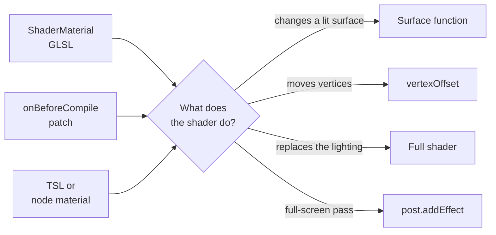

# Porting shaders: GLSL, onBeforeCompile and TSL

> Roadmap step 0.3, first released in null3D 0.1.0. The API is experimental, so it can still change between versions.



null3D shaders are WGSL. The Vite plugin translates each one to GLSL for the WebGL2 path, so you write a shader once. A port reads what the three.js shader does, then writes the smallest null3D form that does the same.

A custom material takes its WGSL in one `wgsl` option, as a template literal tagged `/* wgsl */` or as a `.wgsl` import. The WGSL holds `fn surface`, `fn vertexOffset`, or both. It can also hold a full shader's `@vertex` and `@fragment` entry points. It declares its uniforms once, as `struct Uniforms`, and reads them from `material`. [Custom shaders](../guides/custom-shaders.md) covers the setup, and [Surface functions](../shaders/surface-functions.md) covers the contract.

## Choose the target form

| The three.js shader | The null3D form |
| --- | --- |
| Changes the color, roughness, emission or alpha of a lit surface | A surface function |
| Moves vertices | `vertexOffset`, with a surface function where needed |
| Ignores the lights, such as a hologram or a fresnel glow | An unlit function, `fn unlit(input: SurfaceInput) -> vec4f`, which returns the color and the opacity with no lighting ([Unlit surfaces](../shaders/surface-functions.md#unlit-surfaces)) |
| Replaces three.js's lighting | A full shader with the `null3d::lighting` helpers |
| Is a full-screen pass | `post.addEffect`, or `render.addPass({ kind: 'fullscreen' })` when it writes a target of its own ([Porting post-processing](threejs-postprocessing.md)) |
| Draws into a texture for another material | A scene pass of `render.addPass` |

A surface function keeps instancing, skinning, shadows, fog and both GPU paths. A full shader keeps instancing and both GPU paths. It gets no lighting, shadows, fog, uniforms or standard values, so use one only when a surface function cannot give the look.

## GLSL to WGSL

| GLSL | WGSL |
| --- | --- |
| `float`, `int`, `uint`, `bool` | `f32`, `i32`, `u32`, `bool` |
| `vec2`, `vec3`, `vec4` | `vec2f`, `vec3f`, `vec4f` |
| `ivec3`, `uvec3`, `bvec3` | `vec3i`, `vec3u`, `vec3<bool>` |
| `mat3`, `mat4` | `mat3x3f`, `mat4x4f` |
| `float x = 1.0;` | `var x = 1.0;`, or `let x = 1.0;` for a value that does not change |
| `const float K = 2.0;` at file scope | `const K = 2.0;` |
| `float f(float a) { ... }` | `fn f(a: f32) -> f32 { ... }` |
| `float a[4];` | `var a: array<f32, 4>;` |
| `float(i)`, `int(x)` | `f32(i)`, `i32(x)`. WGSL never converts types by itself. |
| `texture2D(t, uv)`, `texture(t, uv)` | `textureSample(t, tSampler, uv)` |
| `texture2DLod`, `textureLod` | `textureSampleLevel(t, tSampler, uv, lod)` |
| `texture(t, vec3(uv, layer))` on a `sampler2DArray` | `textureSample(t, tSampler, uv, i32(layer))` on a `texture_2d_array<f32>` |
| `texelFetch(t, ivec2(p), 0)` | `textureLoad(t, vec2i(p), 0)` |
| `mod(x, y)` | `x - y * floor(x / y)`. WGSL's `%` keeps the sign of `x`. |
| `atan(y, x)` | `atan2(y, x)` |
| `inversesqrt(x)` | `inverseSqrt(x)` |
| `dFdx`, `dFdy`, `fwidth` | `dpdx`, `dpdy`, `fwidth` |
| `lessThan(a, b)` | `a < b`, which gives a vector of bools |
| `mix`, `step`, `smoothstep`, `clamp`, `fract`, `pow`, `dot`, `cross`, `normalize`, `reflect` | The same names |
| `c ? a : b` | `select(b, a, c)`, with the false value first and the condition last |
| `v.xy = w;` | `v = vec3f(w, v.z);`. Only Chrome allows assignment to a swizzle. |
| `discard;` | `discard;` |
| `gl_FrontFacing` | `input.frontFacing` |
| `gl_FragCoord` | `input.fragCoord`, from the top left (see [Conventions](#conventions)) |
| `gl_InstanceID` | `input.instance`, the row in its batch |
| `gl_VertexID` | `@builtin(vertex_index)` in a full shader |
| `precision highp float;` | Delete it. |
| `#define NAME value` | `const NAME = value;` |
| `#ifdef`, `#if` | `if` on a `const`, which the compiler removes, or two materials |
| `#include <chunk>` | `#import null3d::...` from the [shader library](../shaders/library.md), or delete it |

A custom material samples 2D textures, declared as `var name: texture_2d<f32>;`, and texture arrays, declared as `var name: texture_2d_array<f32>;`. A GLSL `samplerCube` has no equivalent in a material. Sample an equirectangular 2D texture instead, or let the scene's environment light the surface.

## Built-in values

The engine gives each surface function and vertex offset the values that three.js's `ShaderMaterial` adds. [Built-in values](../shaders/builtins.md) lists them all.

| three.js | null3D |
| --- | --- |
| The `position`, `normal`, `uv`, `uv1` and `color` attributes | `VertexInput.position`, `normal`, `uv`, `uv1` and `colors` in `vertexOffset`. `input.uv`, `input.uv1` and `input.vertexColor` in a surface function. |
| `modelMatrix` | `object.worldMatrix`, with its translation relative to the camera. `object.position` gives the origin in the world. |
| `viewMatrix`, `projectionMatrix` | `camera.view`, which holds the rotation only, and `camera.projection`, with reversed depth. `camera.viewProjection` is their product. |
| `cameraNear`, `cameraFar` | `camera.near`, `camera.far` |
| `cameraPosition` | `camera.position` |
| `modelViewMatrix * vec4(position, 1.0)` | Nothing: the engine places the vertices. A full shader calls `clip_position` from `null3d::mesh`. |
| `normalMatrix`, in view space | `input.normal` is already in world space. Multiply it by `camera.view` for view space. |
| Varyings such as `vWorldPosition`, `vViewDir` and `vNormal` | `input.worldPosition`, `input.viewDirection`, `input.normal` |
| `instanceMatrix`, `instanceColor` | The engine applies each row's transform. A batch made with `colors: true` multiplies each row's color into `input.vertexColor`. |
| An `InstancedBufferAttribute` such as a phase per instance | `object.values`, four floats per row from a batch made with `values: true` |
| A `time` uniform that the app updates | `frame.time` |
| The fog, tone mapping and color space chunks | Nothing: the engine adds fog after the surface function, and the final pass tone maps and encodes once. |
| The `<common>` and `<packing>` helpers | `null3d::math`, `null3d::depth` |
| The lighting chunks and light uniforms | The engine lights a surface function. A full shader imports `null3d::lighting`. |

The engine works relative to the camera, so positions stay precise far from the origin. That is why `object.worldMatrix` and `camera.view` hold no camera translation.

## Conventions

- **Fragment coordinates.** `input.fragCoord` counts pixels from the top left, with y pointing down, on every GPU path. GLSL's `gl_FragCoord` starts at the bottom left. Replace `gl_FragCoord.y` with `frame.resolution.y - input.fragCoord.y`.
- **Screen coordinates in effects.** An effect's `input.uv` is (0, 0) at the top left. three.js's full-screen passes use a `vUv` that starts at the bottom left. Replace `vUv.y` with `1.0 - input.uv.y` where the direction matters.
- **Texture coordinates.** A texture loaded with `flipY: true` samples as three.js's `TextureLoader` does. glTF textures use `flipY: false` in both engines, so the shader's math stays the same.
- **Depth.** The engine uses reversed depth on both GPU paths: near is 1 and far is 0. Use `null3d::depth::linear_depth` and `null3d::depth::perspective_depth_to_view_z` in place of three.js's depth formulas.
- **Color.** A surface's colors are linear, and the final pass encodes sRGB once. A three.js `ShaderMaterial` without `<colorspace_fragment>` wrote sRGB values straight to the screen. Convert such constants with `null3d::color::srgb_to_linear`, or pass them as `'#rrggbb'` uniforms, which the engine converts.
- **Matrices.** Both engines store matrices by column, and `matrix * vector` keeps its order.

## ShaderMaterial and RawShaderMaterial

1. List the uniforms. Each becomes a field of `struct Uniforms`, with its first value in the `uniforms` option. A `sampler2D` uniform becomes `var name: texture_2d<f32>;` and an entry of the `textures` option, and a `sampler2DArray` becomes `var name: texture_2d_array<f32>;`. A material takes up to 6 textures, fixed when you create it.
2. Replace each update such as `material.uniforms.uSpeed.value = 2` with `material.set({ speed: 2 })`. A name that `struct Uniforms` lacks fails the type check, and throws [E1216](../errors/E1216.md) when the sketch runs.
3. Read the vertex shader. When it only places the vertices and passes varyings on, delete it. When it moves vertices, port that part as `vertexOffset`.
4. Read the fragment shader. Map its varyings to the surface input, and its output to the surface's fields. A lit look goes to `baseColor`, `roughness` and `metalness`. An unlit look goes to the color that `fn unlit` returns, in place of `surface`. Transparency goes to `alpha`, or to the opacity that `fn unlit` returns, with the matching `alphaMode`.
5. Set the options that were material flags. `transparent` becomes `alphaMode: 'blend'`, `side: DoubleSide` becomes `doubleSided: true`, and `AdditiveBlending` becomes `blending: 'additive'`.
6. Compare parity images on WebGPU and WebGL2 ([Verifying a port](verification.md)).

A `RawShaderMaterial` adds nothing by itself, so every matrix and attribute is in its source. The same steps apply.

Uniforms take `f32`, `i32`, `u32`, `vec2f`, `vec3f` and `vec4f`, up to 32 numbers in all. Pass a matrix as `vec4f` rows. Rename a uniform called `color`, `roughness` or another standard value, because those names belong to the material.

## onBeforeCompile patches

| What the patch does | The null3D form |
| --- | --- |
| Changes `transformed` after `#include <begin_vertex>` | `vertexOffset`, which returns the change: the new position minus the old |
| Changes `diffuseColor` after `<map_fragment>` or `<color_fragment>` | `s.baseColor` and `s.alpha` in a surface function |
| Changes `roughnessFactor` or `metalnessFactor` | `s.roughness`, `s.metalness` |
| Adds glow in `<emissivemap_fragment>` | `s.emissive` |
| Adds `discard`, for a dissolve or a cut-out | `alphaMode: 'mask'` and `s.alpha` |
| Adds a varying such as a world position | `input.worldPosition` |
| Replaces a lighting chunk | A full shader with `null3d::lighting` |
| Keeps `shader.uniforms` to update them later | `material.set({ ... })`, or `frame.time` for time |

Keep the original material's standard values on the new material. `materials.shader` takes every `materials.standard` option but the texture maps, and `defaultSurface()` starts from them. The original's maps become textures of the WGSL, which the surface function samples.

## TSL and node materials

| TSL | WGSL in a surface function |
| --- | --- |
| `uniform(0.5)`, and `u.value = x` | `uniforms: { name: 0.5 }`, and `material.set({ name: x })` |
| `texture(map, uv())` | `textureSample(map, mapSampler, input.uv)`, with the texture in the `textures` option |
| `uv()`, `uv(1)` | `input.uv`, `input.uv1` |
| `modelWorldMatrix`, `cameraViewMatrix`, `cameraProjectionMatrix` | `object.worldMatrix`, `camera.view`, `camera.projection` |
| `positionGeometry`, `positionLocal` | `VertexInput.position` in `vertexOffset` |
| `positionWorld`, `normalWorld` | `input.worldPosition`, `input.normal` |
| `normalView` | `(camera.view * vec4f(input.normal, 0.0)).xyz` |
| `cameraPosition`, `time` | `camera.position`, `frame.time` |
| `vertexColor()`, `instanceIndex` | `input.vertexColor`, `input.instance` |
| `screenUV`, `screenCoordinate` | `input.fragCoord.xy / frame.resolution`, and `input.fragCoord.xy` |
| `add`, `sub`, `mul`, `div` | `+`, `-`, `*`, `/` |
| `oneMinus(x)`, `saturate(x)` | `1.0 - x`, `saturate(x)` |
| `mx_noise_float(p)` and other MaterialX noise | `null3d::noise::simplex3(p)` and `fbm3(p, octaves)`. The values differ, so tune them. |
| `Fn`, `If`, `Loop`, `.toVar()` | `fn`, `if`, `for`, `var` |
| `colorNode`, `opacityNode`, `roughnessNode`, `metalnessNode`, `normalNode`, `emissiveNode`, `aoNode` | `s.baseColor`, `s.alpha`, `s.roughness`, `s.metalness`, `s.normal`, `s.emissive`, `s.occlusion` |
| `positionNode` | `vertexOffset`, which returns `newPosition - input.position` |
| `fragmentNode`, `outputNode` | A full shader, or a post effect for a post-processing `outputNode` |
| `mrtNode` | No equivalent |

On an `InstancedMesh`, three.js applies the instance matrix before `positionNode` runs, so `positionLocal` there holds the instanced vertex. In null3D, `input.position` is always the mesh's own vertex, and the engine applies the row's transform after `vertexOffset`. Write such a displacement from `input.position` and the row's own data.

## Displacement

For three.js's `displacementMap`, use the standard material's own `displacementMap`, `displacementScale` and `displacementBias`. Shadows, the depth prepass and the culling bounds then follow the moved vertices.

Write a vertex offset for a height map that the standard material cannot take, such as one that moves along another direction:

```ts
const ground = materials.shader({
  color: '#7a8a5a', roughness: 0.9,
  uniforms: { scale: 2.0, bias: 0.0 },
  textures: { height: heightMap },
  wgsl: /* wgsl */ `
    struct Uniforms { scale: f32, bias: f32 }

    var height: texture_2d<f32>;

    fn vertexOffset(input: VertexInput) -> vec3f {
      let h = textureSampleLevel(height, heightSampler, input.uv, 0.0).r;
      return input.normal * (h * material.scale + material.bias);
    }`,
});
groundMesh.setBounds([0, 1, 0], 60); // hold the highest moved point
```

The vertex stage has no automatic mip level, so it uses `textureSampleLevel`. The engine does not recompute the normals after a vertex offset. Give `flatShading: true` to light the faces by their moved positions, or bend `s.normal` in the surface function.

## Worked examples

### A fresnel glow from a ShaderMaterial

```glsl
// three.js vertex shader
varying vec3 vNormal; varying vec3 vViewDir;
void main() {
  vec4 mv = modelViewMatrix * vec4(position, 1.0);
  vNormal = normalize(normalMatrix * normal);
  vViewDir = normalize(-mv.xyz);
  gl_Position = projectionMatrix * mv;
}
// three.js fragment shader
uniform vec3 uColor; uniform float uPower;
varying vec3 vNormal; varying vec3 vViewDir;
void main() {
  float f = pow(1.0 - max(dot(vNormal, vViewDir), 0.0), uPower);
  gl_FragColor = vec4(uColor * f, f);
}
```

```ts
const glow = materials.shader({
  alphaMode: 'blend', blending: 'additive', depthWrite: false,
  uniforms: { glowColor: '#44aaff', power: 3 },
  wgsl: /* wgsl */ `
    struct Uniforms { glowColor: vec3f, power: f32 }

    fn unlit(input: SurfaceInput) -> vec4f {
      let f = pow(1.0 - max(dot(input.normal, input.viewDirection), 0.0), material.power);
      return vec4f(material.glowColor * f, f);
    }`,
});
```

The original works in view space and the port in world space. The dot product is the same in both. The vertex shader goes, because it only placed the vertices and passed data on.

### Wind sway from onBeforeCompile

```js
// three.js
material.onBeforeCompile = (shader) => {
  shader.uniforms.uTime = timeUniform;
  shader.vertexShader = 'uniform float uTime;\n' + shader.vertexShader.replace(
    '#include <begin_vertex>',
    '#include <begin_vertex>\ntransformed.x += sin(uTime * 2.0 + position.y) * 0.1 * position.y;');
};
```

```ts
const foliage = materials.shader({
  color: '#4f7a32', doubleSided: true,
  uniforms: { strength: 0.1 },
  wgsl: /* wgsl */ `
    struct Uniforms { strength: f32 }

    fn vertexOffset(input: VertexInput) -> vec3f {
      let sway = sin(frame.time * 2.0 + input.position.y) * material.strength * input.position.y;
      return vec3f(sway, 0.0, 0.0);
    }`,
});
```

### A dissolve from TSL

```js
// three.js TSL
const progress = uniform(0);
const n = texture(noiseTex, uv()).r;
material.opacityNode = step(progress, n);
material.emissiveNode = color(0xff6a00).mul(smoothstep(0.05, 0.0, n.sub(progress)).mul(4));
material.alphaTest = 0.5;
```

```ts
const dissolve = materials.shader({
  alphaMode: 'mask', alphaCutoff: 0.5,
  uniforms: { progress: 0, edgeColor: '#ff6a00' },
  wgsl: /* wgsl */ `
    #import null3d::noise::{fbm2}

    struct Uniforms { progress: f32, edgeColor: vec3f }

    fn surface(input: SurfaceInput) -> Surface {
      var s = defaultSurface(input);
      let n = fbm2(input.uv * 8.0, 4u) * 0.5 + 0.5;
      s.alpha = step(material.progress, n);
      let edge = 1.0 - smoothstep(0.0, 0.05, n - material.progress);
      s.emissive = material.edgeColor * edge * 4.0;
      return s;
    }`,
});
```

`opacityNode` becomes `s.alpha`, `emissiveNode` becomes `s.emissive`, and `alphaTest` becomes `alphaMode: 'mask'` with `alphaCutoff`. The port makes its noise with `null3d::noise` in place of a noise texture.

## Pitfalls

- A `textureSample` inside a branch that differs between pixels breaks a WGSL rule that GLSL does not have. Chrome refuses such a shader. Sample before the branch, or use `textureSampleLevel`.
- `%` is not `mod`: negative inputs give other results.
- WGSL has no assignment to a swizzle in most browsers. Write the whole vector.
- Flip y for `gl_FragCoord` and for full-screen coordinates.
- Replace three.js's depth formulas with the `null3d::depth` helpers.
- Convert raw sRGB constants from a `ShaderMaterial` to linear.
- three.js's `normalMatrix` works in view space, and null3D's normals are in world space.
- WGSL does not mix `f32` and `i32` in arithmetic, so convert explicitly.
- A surface function shares its file with the engine's template. Rename GLSL helpers whose names clash with it, such as `frame`, `camera`, `object`, `material`, `shade` or `finish` ([WGSL rules](../shaders/wgsl-rules.md)).
- Test on WebGL2 with `?gpu=webgl2`. The translated GLSL can meet limits that the WGSL did not.

## Related pages

- [Custom shaders](../guides/custom-shaders.md)
- [Surface functions](../shaders/surface-functions.md)
- [Built-in values](../shaders/builtins.md)
- [WGSL rules](../shaders/wgsl-rules.md)
- [The shader library](../shaders/library.md)
- [Porting materials and textures](threejs-materials.md)
- [Porting post-processing](threejs-postprocessing.md)
