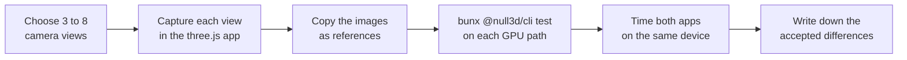

# Verifying a port

> Roadmap step 0.3, first released in null3D 0.1.0. The API is experimental, so it can still change between versions.



A port is done when each chosen camera view looks the same as the original within an agreed tolerance, on every GPU path. It must also run at least as fast as the original on the same device. This page shows how to check both with the command line tool.

## Choose the views

Pick 3 to 8 camera views that together show every material, light, effect and kind of object in the app. Write each view down with its camera and its animation time:

```json
{
  "size": [800, 450],
  "pixelRatio": 1,
  "views": [
    { "name": "overview", "position": [8, 6, 10], "target": [0, 1, 0], "fov": 50, "time": 0 },
    { "name": "hero-closeup", "position": [1.2, 1.6, 2], "target": [0, 1.4, 0], "fov": 35, "time": 1.5 }
  ]
}
```

A fixed size and a pixel ratio of 1 make the two engines' images comparable.

## Capture the three.js images

Make the original app give the same frame on every run first:

- Stop the damping and the auto-rotation of its controls.
- Set each animation mixer to the view's time with `mixer.setTime(time)`, and set each time uniform to the same value.
- Replace `Math.random` with a seeded generator while you capture, if the scene uses randomness.
- Keep anti-aliasing on in three.js, and start null3D with `createEngine({ antialias: 'msaa' })`. Both then draw 4 samples per pixel.
- Match the tone mapping. null3D tone maps with punchy AgX by default, which three.js lacks. An original with `NoToneMapping` needs `post.set({ toneMapping: 'none' })`.

Then add a short helper to the original app, and remove it after you capture:

```js
// capture-baseline.js
export function captureBaseline(renderer, scene, camera, config, renderFn = () => renderer.render(scene, camera)) {
  renderer.setPixelRatio(config.pixelRatio);
  renderer.setSize(config.size[0], config.size[1], false);
  const shots = {};
  for (const v of config.views) {
    camera.position.fromArray(v.position);
    camera.lookAt(v.target[0], v.target[1], v.target[2]);
    if (camera.isPerspectiveCamera && v.fov) camera.fov = v.fov;
    camera.aspect = config.size[0] / config.size[1];
    camera.updateProjectionMatrix();
    renderFn(); // composer.render() for an app with post-processing
    shots[v.name] = renderer.domElement.toDataURL('image/png');
  }
  return shots; // save each data URL as baseline/<name>.png
}
```

With `WebGLRenderer`, a read of the canvas in the same task as the render works without `preserveDrawingBuffer`. With `WebGPURenderer`, call `await renderer.renderAsync(scene, camera)` first. Write the three.js version, the browser and the GPU down beside the images.

## Compare the port with image tests

`bunx @null3d/cli test` compares images with references ([The `null3d` command](../cli/null3d.md#test)). Make each view an image test, with the three.js image as its reference:

1. Let the sketch pose its camera from a view name in its module's address. In the setup, read `new URL(import.meta.url).searchParams.get('view')`, and set the camera from that view ([Testing your sketch](../guides/testing.md)).
2. List one test for each view in `null3d.json`, with the view's time and the size of the three.js images:

   ```json
   {
     "tests": [
       { "name": "overview", "sketch": "sketch.ts?view=overview", "hold": 0, "size": "800x450" },
       { "name": "hero-closeup", "sketch": "sketch.ts?view=hero-closeup", "hold": 1.5, "size": "800x450" }
     ]
   }
   ```

3. Copy each three.js image to `tests/references/<environment>/<tier>/<name>.png`, once for each tier: `webgpu`, `compat` and `webgl2`. The environment is `chrome-real-gpu` on your computer's GPU, and `chromium-swiftshader` with `CI=1`.
4. Run `bunx @null3d/cli test`. For a view that fails, open its image and its `-diff.png` in `test-results/null3d/<environment>/<tier>/`.

A view passes when at most 0.1% of its pixels differ by more than 10% of the color range, as in three.js's own image tests. The pixels on anti-aliased edges never count.

Never run `bunx @null3d/cli test --update-references` in this setup. It replaces the three.js images with the port's own images.

A sketch test draws with the engine's default options. When your page passes options to `createEngine` that change the image, give the test a `page` in place of a `sketch`, such as `"page": "/?view=hero-closeup"`. To look at one view, `shot` draws it:

```sh
bunx @null3d/cli shot --page '/?view=hero-closeup' --time 1.5 --size 800x450 --gpu webgl2 --out compare/hero-closeup.png
```

## Tolerances

| Scene content | Tolerance | Why |
| --- | --- | --- |
| Meshes, unlit and standard materials, lights, fog and tone mapping, without shadows or effects | Under 0.1% of pixels | The engine's own parity scenes stay under it on every GPU path. |
| The same with directional shadows | Under 0.5% of pixels | The shadow edges differ, because the two engines filter shadow maps in other ways. |
| Lambert, Phong or Toon materials | Review the diff image | Those materials become approximations ([Porting materials and textures](threejs-materials.md)). |
| Bloom, ambient occlusion and other effects | Review the diff image | The two engines build these effects in other ways. |
| Text and HTML labels | Compare in the browser | Labels are HTML on the page, and images leave them out. |

Some known differences need a tolerance of their own, or a matched setting:

- **Anti-aliased edges with tone mapping.** null3D averages an edge's samples before it tone maps them, and `WebGLRenderer` after. Where a very bright surface meets a dark one, the edge pixels differ. Compare such views with anti-aliasing off on both sides.
- **Fog in a wide view.** null3D measures the straight-line distance from the camera, and three.js the depth along the view. A wide view gets more fog at its corners. Compare the middle of the view, or review the corners.
- **The background.** null3D tone maps and exposes the background with the scene. `WebGLRenderer` clears to `scene.background` as it is. With an exposure other than 1, the two backgrounds differ.
- **Hemisphere lights.** three.js points the sky from the light's position toward the origin, and null3D along the light's +Y axis. Turn the null3D light to match a `HemisphereLight` that is not upright.

Write each accepted difference down, with its reason.

## Compare performance

Measure both apps on the same device, browser, window size and pixel ratio, with the display at 60 Hz. Time a production build of each app: `bunx vite build`, then `bunx vite preview`. Never time null3D on the dev server. The dev server runs the engine's development checks in every frame, so the port looks slower than it ships.

`bunx @null3d/cli bench` makes a production build of the null3D app, and measures it ([The `null3d` command](../cli/null3d.md#bench)):

```sh
bunx @null3d/cli bench --gpu webgpu,webgl2 --runs 5 --seconds 30 --size 800x450
```

It warms up for 5 seconds by default, which leaves out the shader builds, and reports the medians and the spread of its runs.

| Measure | three.js | null3D |
| --- | --- | --- |
| Frame time at the 50th, 95th and 99th percentile | The intervals between frames that drew, counted as below | `intervalMs` from `engine.measure(seconds)`, or from `bench`, with `completedFps` beside it |
| CPU time per frame on the busiest thread | `performance.now()` around the update and the render | `cpuMs`, with each thread's phases in `threads` |
| Main thread time per frame | The same as above, because everything runs there | Close to zero |
| Memory | The browser's memory panel | `memory` from `engine.measure()` |
| Time to the first frame | From navigation to the first frame that drew | `load` from `engine.measure()` |
| Download size | The network panel, compressed | The same |

A `requestAnimationFrame` callback keeps firing while the GPU falls behind. `WebGPURenderer` can also return from a render with nothing drawn while its pipelines build. So count the three.js frames that drew and the frames that the GPU finished, and compare with the lower rate:

```js
// three.js with WebGPURenderer's WebGPU backend
let drawn = 0;
let finished = 0;
renderer.setAnimationLoop(() => {
  renderer.render(scene, camera);
  if (renderer.info.render.drawCalls > 0) drawn++;
  renderer.backend.device.queue.onSubmittedWorkDone().then(() => { finished++; });
});
```

With `WebGLRenderer`, place a fence with `gl.fenceSync` after each render. Count the frame as finished when a later frame finds the fence signaled.

When the original app was not optimized, part of the gain comes from the rewrite, not from the engine. Say so when you report the figures.

## The WebGL2 path

Many phones have no WebGPU, so they draw the port with WebGL2. Check every view on WebGL2 too:

- `bunx @null3d/cli test` draws each test on all three tiers unless a test lists its own `tiers`. `--gpu webgl2` runs that path alone.
- `?gpu=webgl2` in the page's address forces the path in a browser.
- `bunx @null3d/cli bench --gpu webgl2` times it.

The engine translates every shader for WebGL2. A translated shader can meet a limit that the WGSL did not, so a custom shader that passes on WebGPU can fail on WebGL2. [GPU tiers and backends](../concepts/backends.md) lists what each path gives.

## Phones and tablets

A port that is faster on a computer is not always faster on a phone. Test on the devices that your users have:

- Serve the build over HTTPS on your local network, so that the device gets shared memory and WebGPU ([Hosting and cross-origin isolation](../getting-started/hosting.md#during-development)).
- Run each test for 10 minutes at least once. Phones slow down as they heat up.
- Compare at the quality preset that the engine picks on the device. A phone starts at Low and a tablet at Medium ([Quality presets](../concepts/quality-presets.md)).

[Phones and tablets](../guides/phones.md) says more about testing on a device.

## Write down the result

Keep a short report beside the port. Give each device and browser, and the views that pass on each GPU path. Give the frame times of both apps, and each accepted difference with its reason. Add the commands that run the checks again, so that a later change can repeat them.

## Related pages

- [Testing your sketch](../guides/testing.md)
- [The `null3d` command](../cli/null3d.md)
- [Performance guide](../guides/performance.md)
- [Porting from three.js](threejs-overview.md)
- [Porting materials and textures](threejs-materials.md)
